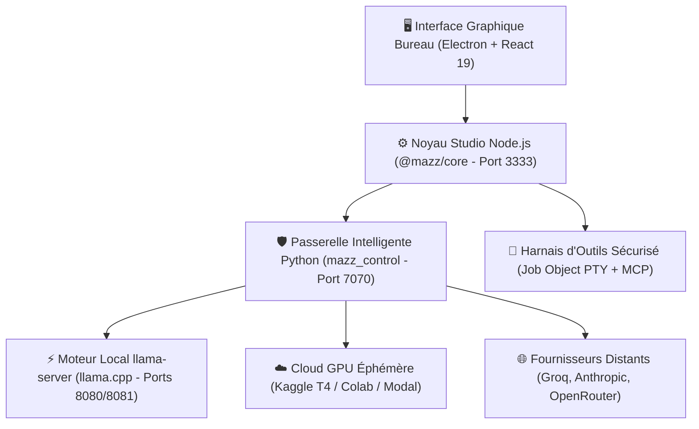



# MAZZ Code
### Studio de Développement Souverain & Orchestrateur d'Agents IA Autonomes
**Local-First • Default-Deny • Inférence Locale GGUF • Hybridation Cloud Éphémère**

---

## 📖 En quelques mots : Qu'est-ce que MAZZ Code ?

**MAZZ Code** est un environnement de développement assisté par intelligence artificielle conçu pour offrir une **indépendance technologique totale**. 

Contrairement aux solutions propriétaires du marché (comme Cursor ou GitHub Copilot) qui imposent des abonnements payants mensuels et envoient votre code source sur des serveurs distants, **MAZZ Code tourne à 100 % sur votre machine Windows**. 

Il intègre son propre moteur d'inférence locale (`llama.cpp`), capable d'exécuter des modèles d'intelligence artificielle au format ouvert `.gguf` directement sur votre processeur (CPU) ou votre carte graphique (GPU). 

Lorsque vous avez besoin d'une puissance colossale pour résoudre un problème très complexe, MAZZ Code est capable d'orchestrer automatiquement des **serveurs d'inférence éphémères sur des quotas GPU gratuits** (Kaggle T4, Google Colab, Modal), sans jamais vous faire payer d'abonnement.

---

## 🎯 Comment ça fonctionne ?

MAZZ Code s'articule autour de 4 couches indépendantes et coordonnées :

1. **L'Interface Utilisateur (Bureau)** : Une application moderne fluide conçue avec React 19 et Electron, offrant un éditeur multi-fichiers, un terminal intégré sécurisé, une visualisation 3D des flux agentiques, et une gestion intuitive des modèles.
2. **Le Noyau Studio (`@mazz/core`)** : Orchestre l'agent d'ingénierie logicielle, maintient l'état du projet, décompose les objectifs en graphes de tâches exécutables, et applique le protocole standardisé MCP (*Model Context Protocol*).
3. **La Passerelle Intelligente (`mazz_control`)** : Un routeur neuronal en Python FastAPI qui analyse la complexité de chaque tâche et décide en temps réel du meilleur modèle à solliciter (local ou distant), tout en fournissant une compatibilité totale avec les protocoles Anthropic et OpenAI.
4. **Le Harnais de Sécurité (*Default-Deny*)** : Aucun script, aucune modification de fichier hors du projet, aucun terminal n'est exécuté sans autorisation explicite de l'utilisateur. Chaque processus est confiné dans des objets de tâche Windows (*Windows Job Objects*).

---

## 📦 Les Deux Versions Disponibles

MAZZ Code est distribué sous deux formes prêtes à l'emploi, entièrement purgées de toute donnée privée ou compte développeur :

### 1. Version Installeur Windows (`Mazz-Code-1.2.0-Setup.exe`)
* Idéale pour une installation propre et permanente sur votre ordinateur Windows.
* Déploie automatiquement les runtimes embarqués (Node 24, Python 3.12, llama-server) sans nécessiter aucune configuration préalable de votre système.
* Raccourci sur le Bureau et menu Démarrer.

### 2. Version Portable Autonome (`Mazz-Code-1.2.0-Portable.zip`)
* Idéale pour une utilisation sans installation ou depuis un disque externe / clé USB.
* Décompressez simplement l'archive où vous le souhaitez et lancez `Mazz Code.exe` (ou `Lancer MAZZ.cmd`).
* Grâce au marqueur `portable.flag`, l'application n'écrit absolument rien dans `%APPDATA%` ni dans la base de registre : tous les réglages, sessions et données restent confinés dans le dossier local `data\`.

---

## 🚀 Guide de Démarrage Rapide

### Utilisation avec un modèle d'IA local (100% Hors-Ligne) :
1. Téléchargez un modèle de code au format `.gguf` (par exemple : `Qwen2.5-Coder-7B-Instruct-Q4_K_M.gguf` ou `Llama-3.2-3B-Instruct.gguf` sur Hugging Face).
2. Déposez votre fichier `.gguf` dans le dossier `models/` situé dans le répertoire de l'application.
3. Lancez MAZZ Code.
4. Dans l'onglet **Modèles**, cliquez sur **Scanner** et sélectionnez votre modèle. Vous pouvez coder et poser vos questions immédiatement, sans connexion internet !

### Raccourcis Principaux

| Raccourci | Action |
| :--- | :--- |
| `Ctrl + K` | Palette de commandes globale |
| `Ctrl + Entrée` | Envoyer l'instruction à l'agent de code |
| `Échap` | Interrompre la tâche en cours |
| `Ctrl + S` | Sauvegarder le fichier actif |
| `Ctrl + Shift + F` | Recherche textuelle dans tout le projet |

---

## 🛡️ Confidentialité & Sécurité

* **Zéro Télémétrie Cachée** : MAZZ Code ne collecte aucune donnée à votre insu.
* **Stockage Local Intégral** : Vos sessions, contextes et historiques de code sont conservés exclusivement sur votre disque dur dans une base SQLite locale.
* **Sécurité Default-Deny** : L'agent IA n'a pas accès en écriture libre à votre système d'exploitation.

---

## ⚙️ Configuration Matérielle Requise

* **Système d'exploitation** : Windows 10 ou Windows 11 (64-bit).
* **Processeur (CPU)** : Compatible AVX2 (pratiquement tous les processeurs Intel Core depuis 2013 et AMD Ryzen).
* **Mémoire vive (RAM)** :
  * Modèles légers (1B à 3B) : 8 Go de RAM.
  * Modèles intermédiaires (7B à 8B) : 16 Go de RAM.
  * Modèles avancés (14B à 32B) : 32 Go de RAM ou carte graphique dédiée.
* **Carte graphique (Optionnelle)** : NVIDIA, AMD ou Intel compatible Vulkan / DirectX pour l'accélération matérielle.

---

## ⚖️ Licence & Philosophie

MAZZ Code est développé selon la philosophie **Living Engineering** de l'initiative **MAZZ ÆNGENIUM** : 
le vivant inspire, l'ingénierie donne forme.

Site officiel : [mazz-aengenium.workers.dev](https://mazz-aengenium.workers.dev)  
Auteur : MAZZ ÆNGENIUM / Eren Tipirdamaz
