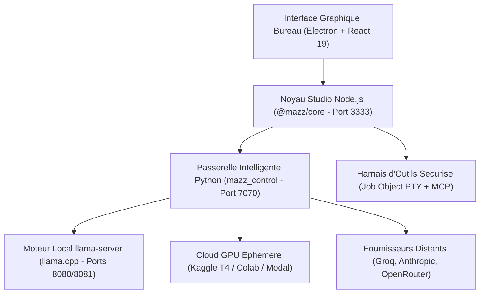

# MAZZ Code
### Studio de Developpement Souverain & Orchestrateur d'Agents IA Autonomes
**Local-First • Default-Deny • Inference Locale GGUF • Hybridation Cloud Ephemere**

---

## En quelques mots : Qu'est-ce que MAZZ Code ?

**MAZZ Code** est un atelier de programmation nouvelle generation cree au sein de **MAZZ AENGENIUM**.

Imaginez que vous avez un assistant super-intelligent assis a vos cotes pour vous aider a fabriquer vos jeux video, vos sites web ou vos logiciels. Vous lui expliquez en francais ce que vous souhaitez accomplir, et il reflechit, vous explique la demarche et ecrit le code avec vous.

Contrairement aux outils proprietaires du marche (comme Cursor ou GitHub Copilot) qui imposent des abonnements payants mensuels et envoient vos projets sur des serveurs distants, **MAZZ Code fait exactement l'inverse** :
- **100 % chez vous** : Le studio et ses cerveaux d'intelligence artificielle tournent directement sur votre ordinateur Windows.
- **Zero abonnement** : Aucun paiement, aucune carte bancaire requise, aucun frais cache.
- **Fonctionne hors-ligne** : Vous pouvez programmer dans le train, en deplacement ou sans connexion Internet.
- **Vie privee inviolable** : Vos idees, codes sources et donnees ne quittent jamais votre disque dur.

---

## Les 4 super-pouvoirs de MAZZ Code

1. **Flotte de modeles interchangeables en 1 clic**  
   Dans l'application (onglet Modeles), choisissez directement parmi les modeles neuronaux souverains MAZZ (Qwen, DeepSeek-R1, Llama, Nemotron). Le telechargement direct au format GGUF est integre, gratuit et sans aucun compte requis.

2. **Pret de super-ordinateurs gratuits dans le cloud**  
   Si votre ordinateur ne dispose pas d'une carte graphique imposante pour les modeles lourds, MAZZ Code peut temporairement emprunter des quotas de calcul gratuits (Kaggle T4 x2, Google Colab ou Modal) pour effectuer le travail lourd, puis les eteindre des que c'est termine.

3. **Securite maximale (Default-Deny)**  
   L'assistant ne peut rien casser a votre insu : il ne modifie aucun fichier sensible et ne lance aucune commande systeme sans solliciter votre accord explicite a l'ecran.

4. **Tout votre atelier reuni dans une fenetre**  
   Profitez d'un editeur de code multi-panneaux, d'un terminal integre securise et d'un radar visuel qui affiche en temps reel le raisonnement pas-a-pas de l'intelligence artificielle.

---

## Flotte de Modeles Souverains MAZZ

MAZZ Code propose en acces public direct la flotte de modeles neuronaux hebergee sur Hugging Face (`mazz92/mazz-models`), en lecture seule anonyme et sans cle d'acces requise :

- **Tier 1 : Grand Public & CPU Local (Edge Sovereign)**
  - `Mazz-Technos-Draft-0.8B-Surgical.Q8_0.gguf` (0,76 Go) : Modèle chirurgical ultra-rapide (>40 tok/s), raisonnement aiguisé sans boucles (méthode MIT CSAIL weight-space programming).
  - `Mazz-Technos-Base-4B.Q4_K_M.gguf` (2,52 Go) : Polyvalent grand public pour PC portables et CPU standards (discussion, rédaction, code).
- **Tier 2 : Ingenierie Logicielle & Raisonnement (Station de Travail)**
  - `Mazz-Technos-TitanCoder-32B-Surgical.Q4_K_M.gguf` (18,5 Go) : Fusion pondérée DeepSeek-R1 (pensée interne) + Qwen2.5-Coder (synthèse de code chirurgicale).
  - `Mazz-Technos-Coder-32B.Q4_K_M.gguf` (18,5 Go) : Champion de la refactorisation et des appels d'outils.
  - `Mazz-Technos-Titan-32B-CoT.Q4_K_M.gguf` (18,5 Go) : Raisonnement scientifique profond avec blocs de réflexion.
- **Tier 3 : Creation Multimodale**
  - `Mazz-Technos-Vision-Flux.Q4_0.gguf` (6,3 Go) : Generation d'images photorealistes en 4 etapes (FLUX.1-schnell).
  - `Mazz-Technos-Motion-Wan.Q8_0.gguf` (1,4 Go) : Generation video cinematique fluide (Wan 2.1 1.3B).
- **Tier 4 : Sommet Cognitif**
  - `Mazz-Technos-ApexCoder-70B-Surgical.Q4_K_M.gguf` (39,6 Go) : Fusion Nemotron-70B + Llama-3.3-70B pour l'audit et l'architecture de depots massifs sur GPU distant.

---

## Calibrage Materiel & Calcul GPU Gratuit

Chaque modele possede des exigences memoire specifiques pour tourner de facon optimale :

| Modele | Poids (.gguf) | En Local (Votre PC) | Sur Kaggle (T4 x2 gratuit) | Sur Google Colab / Modal |
| :--- | :--- | :--- | :--- | :--- |
| **Draft-0.8B** | ~0,8 Go | Des 8 Go de RAM (Immediat) | Compatible (Rapide) | Compatible |
| **Base-4B** | ~2,7 Go | Des 16 Go de RAM (Fluide) | Compatible (Rapide) | Compatible |
| **TitanCoder-32B** | ~19,8 Go | Station 32 a 64 Go de RAM | Limite stricte du disque (~20 Go) | Recommande (50 a 100 Go de disque) |
| **ApexCoder-70B** | ~42,5 Go | Inaccessible sur PC standard | Incompatible (Depasse les 20 Go) | Recommande (Colab ou Modal requis) |
| **Vision-Flux** | ~6,8 Go | Page Calcul GPU requise | Compatible | Compatible |
| **Motion-Wan** | ~1,5 Go | Page Calcul GPU requise | Compatible | Compatible |

### Distinction Fournisseurs : Avec ou Sans Carte Bancaire

- **100 % Gratuits SANS Carte Bancaire (Recommande pour debutants et ados)** :
  - **Kaggle** : Carte graphique NVIDIA T4 double (30 h/semaine). Inscription gratuite sans carte bancaire, validation de telephone par SMS requise. Limite de disque ephemere : 20 Go.
  - **Google Colab** : GPU gratuit sans carte bancaire, 50 a 100 Go de disque (parfait pour TitanCoder-32B et ApexCoder-70B).
- **Avec Carte Bancaire pour Verification d'Identite** :
  - **Modal** : 30 $/mois de calcul offert sur GPU puissants (L40S / A100), mais exige une carte bancaire a l'inscription pour lutter contre les abus (fixez la limite de depense a 0 $ dans votre console Modal).

Consultez le guide detaille : [docs/GUIDE_GPU_GRAND_PUBLIC.md](docs/GUIDE_GPU_GRAND_PUBLIC.md)

---

## Architecture Technique

1. **Interface Bureau (Electron + React 19)** : Station de travail haute fluidite avec editeur multi-onglets, terminal ConPTY et retour visuel d'activite.
2. **Noyau Studio (`@mazz/core`)** : Maintient l'arbre de taches et pilote les outils selon le protocole standard MCP (*Model Context Protocol*).
3. **Passerelle d'Inference (`mazz_control`)** : Serveur FastAPI Python local (port 7070) assurant le routage resilient, la mise en memoire des contextes et la compatibilite OpenAI/Anthropic.
4. **Harnais de Securite Windows (*Default-Deny*)** : Isolation des processus via Windows Job Objects, verification stricte des modifications de fichiers et journalisation complete.

---

## Les Deux Formats de Distribution

MAZZ Code est distribue sans aucune donnee privee ni cle secrete :

### 1. Installeur Windows standard (`Mazz-Code-1.2.2-Setup.exe`)
* Installation permanente sur votre ordinateur Windows.
* Runtimes embarques (Node 24, Python 3.12, llama-server) pre-configures.
* Raccourcis Bureau et menu Demarrer.

### 2. Version Portable autonome (`Mazz-Code-1.2.2-Portable.zip`)
* Fonctionne directement depuis un dossier ou une cle USB sans ecrire dans le registre.
* Tous les reglages, historiques et sessions restent confines dans le sous-dossier `data\`.

---

## Demarrage Rapide en 3 Etapes

1. **Lancez MAZZ Code** sur votre PC.
2. **Ouvrez l'onglet Modeles** : telechargez un premier modele gratuit adapte a votre memoire (ex. Base 4B pour un PC portable).
3. **Ouvrez un dossier de projet** et commencez a dialoguer avec l'assistant.

---

## Raccourcis Clavier

| Raccourci | Action |
| :--- | :--- |
| `Ctrl + K` | Palette de commandes globale |
| `Ctrl + Entree` | Envoyer l'instruction a l'agent |
| `Echap` | Interrompre l'execution en cours |
| `Ctrl + S` | Sauvegarder le fichier actif |
| `Ctrl + Shift + F` | Recherche textuelle globale |

---

## Configuration Requise

* **Systeme** : Windows 10 ou Windows 11 (64-bit).
* **Processeur** : CPU 64-bit compatible AVX2 (Intel Core depuis 2013, AMD Ryzen).
* **RAM recommandee** :
  * Modeles legers (0.8B a 4B) : 8 a 16 Go de RAM.
  * Modeles avances (32B a 70B) : 32 Go+ ou acceleration GPU distante (Calcul GPU).
* **GPU (Optionnel)** : Acceleration Vulkan / DirectX compatible.

---

## Licence & Philosophie

MAZZ Code est developpe selon la philosophie **Living Engineering** de l'initiative **MAZZ AENGENIUM** : 
le vivant inspire, l'ingenierie donne forme.

Site officiel : [https://mazz-aengenium.mazz.workers.dev](https://mazz-aengenium.mazz.workers.dev)  
Auteur : MAZZ AENGENIUM / Eren Tipirdamaz
