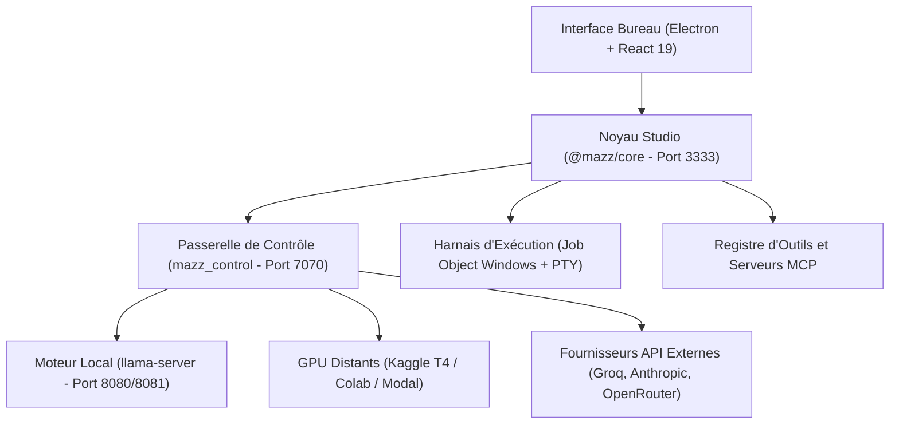

# 01 — Vision et architecture globale de MAZZ Code

## 1. Vision et finalité

MAZZ Code est un studio de développement souverain, orienté agents autonomes, conçu pour tourner intégralement sur une machine Windows standard sans nécessiter d'abonnements cloud obligatoires ni dépendance à des infrastructures tierces privatives.

L'objectif architectural repose sur quatre principes fondateurs :
1. **Souveraineté et exécution locale d'abord** : L'environnement intègre un serveur local d'inférence (`llama-server`) capable de charger des modèles au format GGUF avec accélération CPU et GPU via Vulkan ou AVX2.
2. **Accélération cloud gratuite sans surcoût** : Lorsque les modèles locaux atteignent les limites matérielles du PC hôte (14B, 32B ou charges multimodales intensives), le système déploie automatiquement des serveurs d'inférence éphémères sur des quotas GPU gratuits (Kaggle T4, Google Colab, Modal Labs) avec extinction automatique programmée.
3. **Sécurité par conception (Default-Deny)** : Aucun outil critique (exécution de terminal, écriture de code, accès aux fichiers hors du projet) n'est exécuté sans vérification explicite ou règle validée par l'utilisateur.
4. **Zéro vibration coding** : Le code produit rejette formellement toute duplication visuelle, tout composant fantôme, toute promesse non mesurée et toute erreur silencieuse. Chaque module répond à un contrat strict, vérifié par des suites de tests unitaires et des bancs d'essai (gates).

## 2. Organisation du monorepo

Le code source est articulé en un monorepo TypeScript/Node.js et un runtime Python FastAPI :

### Packages TypeScript (`MAZZ_AGENT_STUDIO/packages/`)
- `@mazz/agent` : Implémente la boucle de raisonnement agentique, la machine à états finis des tours de parole, le graphe de tâches (`TaskHub`) et la politique de compactage d'historique.
- `@mazz/core` : Gère le serveur HTTP local (port 3333), la persistance des sessions en base SQLite et fichiers JSON/JSONL atomiques, le cache KV par session, et l'isolation des espaces de travail.
- `@mazz/tools` : Registre des outils intégrés (`fs.read`, `fs.write`, `fs.patch`, `terminal.run`, `diff.review`) et pont vers les serveurs externes via le protocole MCP (Model Context Protocol).
- `@mazz/providers` : Adaptateurs vers les moteurs d'inférence (OpenAI, Anthropic, serveurs compatibles OpenAI).
- `@mazz/shared` : Types universels, interfaces de requêtes et réponses, schémas de validation.
- `@mazz/model-manager` : Découverte, métadonnées, allocation de mémoire et quantification des fichiers GGUF.
- `@mazz/hermes-bridge` : Normalisation des invites de commandes et formatage structuré selon la grammaire Hermes/ChatML.

### Applications (`MAZZ_AGENT_STUDIO/apps/`)
- `apps/web` : Interface utilisateur monopage construite avec React 19, Vite et Tailwind CSS. Intègre l'éditeur CodeMirror 6 scindé en sous-modules dynamiques, la visualisation 3D (Three.js), l'émulateur de terminal (xterm.js) et le sandboxing des artefacts HTML.
- `apps/desktop` : Enveloppe Electron assurant le cycle de vie du processus sur Windows, l'orchestration des processus enfants, l'intégration système et la barre de titre native sans cadres superflus.
- `apps/cli` : Interface en ligne de commande pour le pilotage sans interface graphique et les tests de non-régression automatisés.

### Passerelle Python (`mazz_control/`)
La passerelle Python FastAPI (port 7070) joue le rôle de contrôleur de route et de proxy de sécurité :
- Émulation complète de l'API `/v1/messages` d'Anthropic pour permettre à tout client standard de consommer les modèles locaux ou distants.
- Routeur intelligent avec disjoncteur (Circuit Breaker) : basculement transparent vers un modèle de repli en cas de défaillance réseau ou d'indisponibilité d'un fournisseur distant.
- Orchestrateur de calcul GPU : génération automatique des scripts d'amorçage pour Kaggle et Colab, synchronisation des poids de modèles avec Hugging Face (`votre-repo/mazz-models`).
- Chiffrement matériel Windows DPAPI pour la sauvegarde des clés et secrets sensibles dans `backends.json`.

