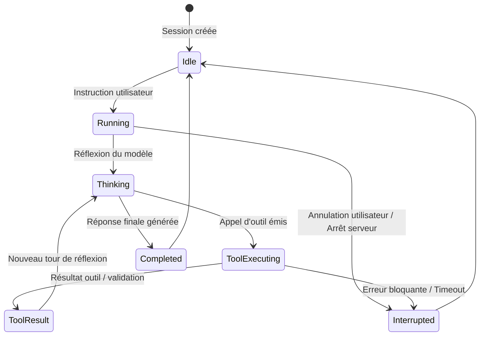

# 02 — Agents : Boucle agentique et contrat de tour

## 1. Machine à états d'un tour de parole

L'exécution d'une instruction au sein de `@mazz/agent` repose sur une machine à états stricte régissant les transitions entre l'utilisateur, l'agent et les outils :

## 2. Structure des événements de flux (SSE)

Les échanges entre le serveur et le client web utilisent les événements serveur (Server-Sent Events) normalisés :
- `turn_start` : Début d'un nouveau tour de parole, initialisation des compteurs de jetons et de temps.
- `thought_delta` : Transmission des fragments de réflexion interne du modèle (blocs `<thinking>`).
- `text_delta` : Fragments de texte destinés à la réponse finale.
- `tool_call` : Notification de la préparation d'un appel d'outil avec ses arguments typés.
- `tool_result` : Résultat brut de l'outil renvoyé au modèle.
- `turn_end` : Clôture du tour, enregistrement dans le journal de session (`<id>.jsonl`) et calcul du coût en jetons.

## 3. Décodage contraint et résilience aux formats de sortie

Pour garantir la stabilité des petits modèles locaux (0.6B, 3B, 4B) qui peuvent parfois omettre un délimiteur de fin ou insérer une virgule traînante dans leurs structures JSON :
- Les schémas d'outils sont injectés sous forme de définitions OpenAI strictes.
- Le module `_repair_tool_args` assainit les blocs d'arguments : retrait des balises Markdown résiduelles, correction des virgules finales, équilibrage automatique des accolades orphelines.

