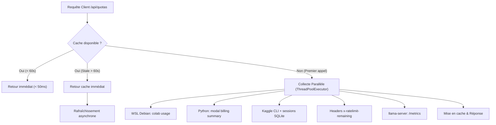

# 03 — Cartographie des fournisseurs, calculs GPU et quotas

## 1. Principes de la gestion des quotas

MAZZ Code applique une règle stricte : **ne jamais deviner une valeur et ne jamais dépenser de budget sans ordre explicite**.
Chaque source de quota interrogée par la passerelle (`/api/quotas`) renvoie un horodatage précis et sa méthode de mesure. En cas d'échec d'interrogation, le système renvoie un statut d'erreur détaillé plutôt qu'un chiffre fictif.

La collecte des quotas s'exécute en parallèle via un pool de threads (`concurrent.futures.ThreadPoolExecutor`), garantissant une réponse en moins de 50 ms grâce à une politique de mise en cache avec réactualisation en arrière-plan (stale-while-revalidate).

## 2. Fournisseurs de calcul GPU pilotés

| Fournisseur | Type de calcul | Quota gratuit vérifié | Cycle de vie & Extinction | Statut d'intégration |
| :--- | :--- | :--- | :--- | :--- |
| **Kaggle GPU** | GPU NVIDIA T4 (16 Go) | 30 heures par semaine (remise à zéro samedi 00:00 UTC) | Arrêt automatique scripté après 60 minutes ou libération immédiate via bouton UI | **Opérationnel à 100%** (Clé Kaggle configurable par l'utilisateur) |
| **Google Colab** | GPU NVIDIA T4 / A100 | Unités de calcul gratuites ou abonnement Pro | Arrêt automatique après inactivité | **Opérationnel** (CLI Debian WSL) |
| **Modal Labs** | Serverless Cloud GPU (L40S / A100) | Crédit mensuel configuré (30 $ de base) | Démarrage à la demande (scale-to-zero), facturation exacte à la seconde | **Opérationnel** (Profil Modal configurable par l'utilisateur) |
| **Hugging Face** | Hub de stockage de modèles | Dépôts privés et publics illimités | Stockage persistant et transferts LFS | **Opérationnel** (`votre-repo/mazz-models`) |
| **Saturn Cloud** | GPU NVIDIA T4 | 0 heure sur plan gratuit (free-org suspendu) | Requiert abonnement | **Marqué expressément « Abonnement requis »** |

## 3. Fournisseurs d'API et inférence managée

La passerelle gère un catalogue de connecteurs sécurisés pour les modèles propriétaires ou open-source hébergés :
- **Groq** : Inférence ultra-rapide par LPU (Llama 3.3, Qwen 2.5), suivi en temps réel via en-têtes HTTP `x-ratelimit-*`.
- **Anthropic Claude** : Support direct via protocole Messages (`claude-3-5-sonnet`, `claude-3-5-haiku`).
- **OpenRouter** : Agrégateur multi-modèles avec basculement automatique.
- **Mistral AI, Cohere, DeepSeek** : Intégrés au routeur intelligent.

## 4. Purge des sessions de test

Pour éviter l'accumulation de sessions orphelines dans `mazz_sessions.db` consécutives aux tests d'évaluation et benchmarks (`/fast Calcule...`), une fonction de purge atomique en un clic est intégrée dans les **Paramètres > Confidentialité**, éliminant les entrées superflues sans impacter les conversations réelles.

