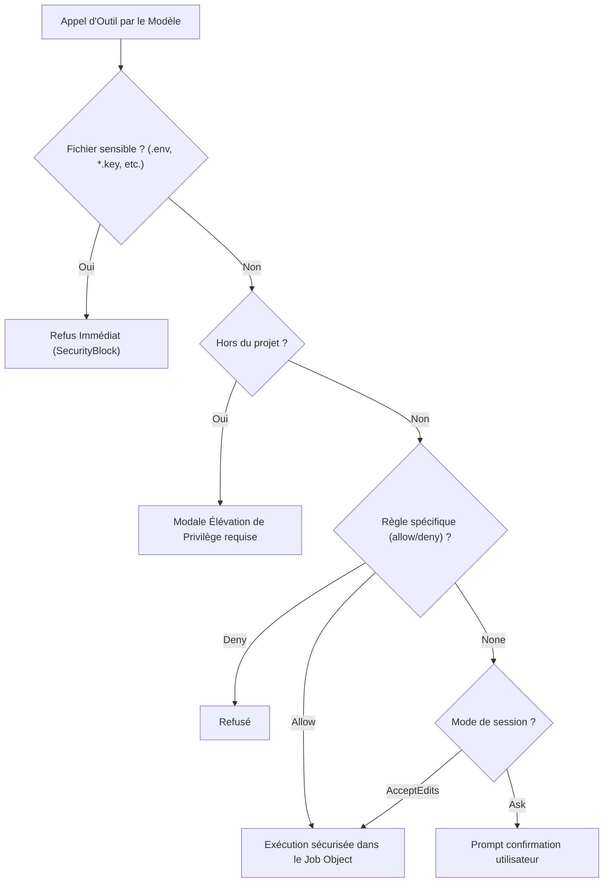

# 04 — Politique de sécurité et garde-fous

## 1. Modèle d'autorisation (Default-Deny)

Le harnais de MAZZ Code applique une politique de sécurité fondée sur le refus par défaut (*default-deny*). Aucune action ayant un impact potentiel sur le système hôte ne peut être exécutée de manière furtive.

L'accès aux outils est gouverné par un mode tripartite :
- **`ask` (Demander)** : Chaque commande de terminal, modification de fichier ou appel d'outil requiert une validation manuelle de l'utilisateur dans l'interface.
- **`allow` (Autoriser dans le projet)** : Les écritures et commandes restent confinées au répertoire racine du projet ouvert. Tout accès en dehors du projet déclenche une modale de confirmation d'élévation de privilège.
- **`deny` (Refuser)** : L'outil est strictement désactivé.

## 2. Protection des fichiers et secrets sensibles

Le serveur bloque systématiquement toute lecture ou écriture portant sur les motifs suivants :
- `.env`, `.env.*`, `*credentials*`, `*secret*`, `*.pem`, `*.key`.
- Clés internes de l'application : `control.key`, `llama.key`, `portable.env`, `modal.toml`, `kaggle.json`.
- Répertoires système sensibles : `%SYSTEMROOT%`, `%APPDATA%\Microsoft\Protect`, etc.

## 3. Chiffrement Windows DPAPI

Toutes les clés d'API (OpenAI, Anthropic, Hugging Face, Groq, etc.) enregistrées via l'interface ou stockées dans `backends.json` sont chiffrées à l'aide de l'API cryptographique native de Windows (**DPAPI** — *Data Protection API* via `CryptProtectData`).
- Le déchiffrement est exclusivement possible par la session de l'utilisateur Windows sur la machine locale.
- Aucun secret en texte clair n'est stocké sur le disque ou affiché dans les journaux d'audit.

## 4. Isolation du terminal et exécution de commandes

Les processus lancés par `terminal.run` ou `terminal.start` bénéficient d'un confinement renforcé :
- **Windows Job Object** : Les commandes sont associées à un objet de tâche Windows avec la limite `JOB_OBJECT_LIMIT_KILL_ON_JOB_CLOSE`. Si le Studio est fermé ou la commande annulée, tous les processus enfants sont immédiatement et proprement terminés, évitant tout processus orphelin en arrière-plan.
- **Assainissement de l'environnement** : Toutes les variables d'environnement système contenant des mots-clés de secrets (`*KEY*`, `*TOKEN*`, `*SECRET*`, `*PASSWORD*`) sont automatiquement purgées de l'environnement transmis au sous-processus.

## 5. Bac à sable des artefacts (ArtifactSandbox)

L'affichage des artefacts interactifs (code HTML, SVG généré) est confiné dans une `iframe` isolée :
- Attributs `sandbox="allow-scripts"` sans `allow-same-origin`, garantissant une origine opaque sans accès aux cookies, au stockage local ou au DOM de l'application.
- Politique de sécurité du contenu (**CSP**) stricte interdisant tout accès réseau sortant (`connect-src 'none'`, `frame-src 'none'`, `form-action 'none'`).

